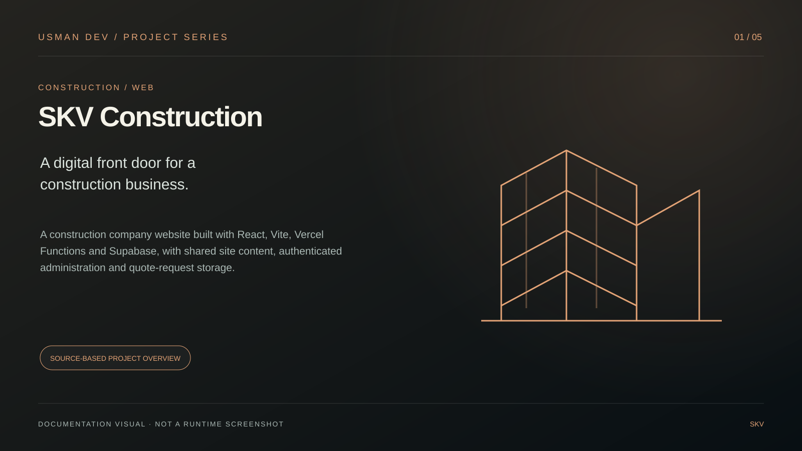

# SKV Construction

A construction company website built with React, Vite, Vercel Functions and Supabase, with shared site content, authenticated administration and quote-request storage.

Project overview illustration; not an application screenshot.

**Status:** Requires configured Supabase and server environment variables. No client results or certifications are claimed.

[Overview graphics](docs/portfolio/) · [Developer portfolio](https://malikusmandev.vercel.app) · [Contact](mailto:usmandev234@gmail.com)

## Local setup

1. Run `npm install`.
2. Copy `.env.example` to `.env.local` and set all four values.
3. In Supabase SQL Editor, run `supabase/schema.sql`.
4. Run `npm run dev`.

## Deploy to Vercel

1. Create a Supabase project and run `supabase/schema.sql`.
2. In Vercel, import this repository and add `SUPABASE_URL`, `SUPABASE_SERVICE_ROLE_KEY`, `ADMIN_PASSWORD`, and `ADMIN_SESSION_SECRET` as encrypted environment variables.
3. Deploy. The public site reads shared content from Supabase; authenticated admin changes and quote requests are stored there.

Never expose `SUPABASE_SERVICE_ROLE_KEY` in browser code or commit `.env.local`.

## Developer contact

[Email](mailto:usmandev234@gmail.com) · [WhatsApp](https://wa.me/923157543808) · [Facebook](https://www.facebook.com/profile.php?id=61594398140960) · [GitHub](https://github.com/MalikUsmanAbid)
